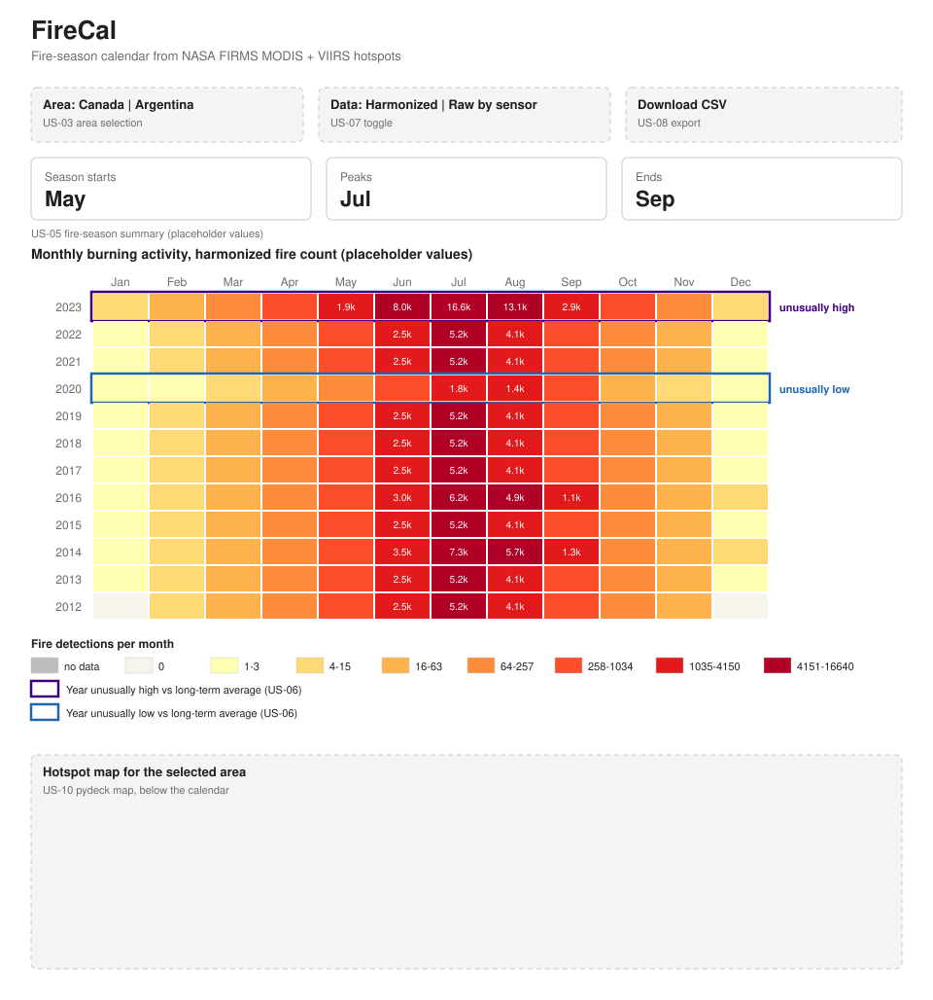

# T-03 Calendar wireframe and colour palette

Draft for review by Mariana (US-04a) and the team. The palette lives in [`src/palette.py`](../src/palette.py); the calendar code imports it rather than hard-coding colours.



The values in the wireframe are placeholders shaped like a Canadian fire season, not real FIRMS data.

## Page layout, top to bottom

1. **Title** and one-line description.
2. **Controls:** area (Canada / Argentina, US-03), data view (harmonized / raw by sensor, US-07), CSV download (US-08).
3. **Season summary:** start, peak and end month for the selected area (US-05).
4. **Calendar:** one row per year (newest at the top, so the latest season is seen first), one column per month, January to December. Peak months show the count as a label (e.g. `5.2k`).
5. **Legend:** no data, zero, the seven activity colours with their count ranges, and the two unusual-year outlines (US-06).
6. **Hotspot map** for the selected area (US-10).

## Colours

| Use | Colour | Hex |
| --- | --- | --- |
| Activity, lowest to highest | yellow → orange → dark red (ColorBrewer YlOrRd, 7 steps) | `#ffffb2` `#fed976` `#feb24c` `#fd8d3c` `#fc4e2a` `#e31a1c` `#b10026` |
| Zero detections (month observed) | warm off-white | `#f7f4ee` |
| No data (month not covered) | grey | `#bdbdbd` |
| Year unusually high | dark purple outline | `#3f007d` |
| Year unusually low | blue outline | `#2166ac` |

## Why these choices

- **One sequential scale** that gets darker as activity rises, so low-to-high still reads for colour-blind viewers and when printed in greyscale.
- **Zero and no data look different.** Zero is a real result; no data means the sensor didn't cover that month (VIIRS starts in 2012). Mixing them up would make early years look fire-free.
- **Log-scale bins.** A peak month can have 1,000 times the detections of a winter month. On a straight scale, only the peak would get any colour. `legend_bins()` prints the count range for each colour, so the legend always matches the cells.
- **Unusual years as outlines**, not fills, so the activity colours stay readable underneath.
- **One colour scale per view.** The darkest colour is the busiest month on screen (`vmax`). When switching areas or raw/harmonized, the scale is recomputed and the legend updates with it.

## How US-04a uses it

```python
from palette import MONTH_LABELS, activity_color, legend_bins, text_color_for

vmax = monthly["count"].max()
fill = activity_color(count, vmax)   # None or NaN -> no-data grey
label_color = text_color_for(fill)   # dark or white text on that cell
for color, label in legend_bins(vmax):
    ...
```

## Open questions for review

- Show count labels on peak cells, or only on hover?
- Does the season summary sit above the calendar (as drawn) or beside it?
